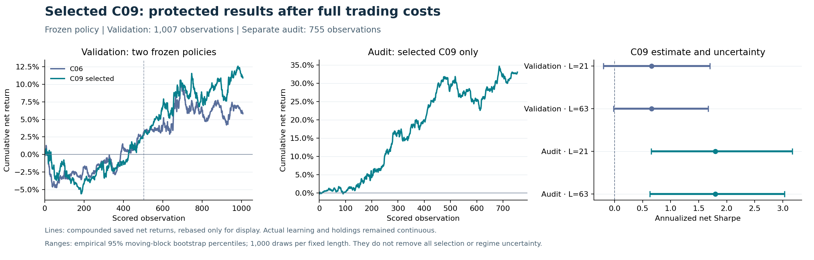

# Continual Research take-home

Private research workspace for the supplied anonymous simulated stock market. The objective is future net Sharpe under the assignment's causal, market-beta and runtime requirements.

## Status

C09 is selected by the frozen validation rule: pooled net Sharpe **0.659210**, versus **0.398603** for discovery leader C06. The unchanged C09 then earned **1.799231 net Sharpe after full costs** in the separately reserved 755-observation audit, with realized net market beta **0.005666**. Its two prespecified audit bootstrap Sharpe ranges remain above zero, while the earlier validation ranges and paired model difference include zero. This is positive evidence under the supplied simulated-market cost model, with future stationarity and the hidden continuation unresolved.

Read [the continued research report](research/CONTINUED_RESEARCH_20261027.md) for all twelve discovery results, literature, contrary evidence, failed attempts and uncertainty. The selected [handoff](handoff/strategy.py) and [four-file ZIP](artifacts/continual_research_C09.zip) reproduce both discovery and the entire canonical audit exactly from a clean directory. `submission/` retains development candidates; its default `strategy.py` is still C01. Use `handoff/` for the selected fixed policy and explicit JSON configurations for research comparisons.

## Start here

- [Master plan](Continual_Research_Master_Plan.md): requirements, research design, exact score windows and release gates.
- [Frozen protocol](RESEARCH_PROTOCOL.json): machine-readable discovery/validation/audit masks and experiment budget.
- [Worklog](WORKLOG.md): current objective, decisions, completed work and next gate.
- [Project rules](AGENTS.md): information access and user-mandated testing policy.
- [Reproduction guide](REPRODUCE.md): original input identities, candidate reruns and verification evidence.
- [Experiment ledger](research/EXPERIMENT_LEDGER.md): prospective admissions, results, diagnostic exposures and remaining budget.
- [Source register](SOURCE_REGISTER.md): task sources, provenance and limits on completed checks.
- `reviews/`: independent requirements, research, verification and artifact reviews.
- `evidence/`: actual executed-run records, including failures.
- `source/Quant Research Take-Home/`: unchanged supplied brief, scorer and examples.

## Data

Restore the large CSVs and supplied figures from the original archive described in REPRODUCE.md. They are excluded from Git; source hashes identify the exact inputs. Cached arrays and bulky derived numerical arrays are also excluded. Small inspectable results, configuration, source snapshots and rerun instructions remain versioned.

Discovery used rows `[0,2016)`. Two frozen policies completed validation on the original masks within `[2016,3024)`, and only the selected unchanged C09 entered audit `[3024,3779)`. These intervals are now exposed and cannot be reused as clean confirmation for a redesigned policy. The employer's continuation remains unobserved. Full-file input hygiene did not substitute for the recorded protected-period admission gates.

## Verification discipline

Prefer complete E2E workflows and save inspectable evidence for every run. If isolated testing is needed, specify failures and outcomes, write the tests, then implement the covered component. Never write unit tests after the implementation they cover. Never describe an unexecuted check as passed.

The employer-facing handoff is the verified compact strategy module and declared helpers. This repository preserves the research trail needed to assess and reproduce it. No external submission has been made.

`RESEARCH_PROTOCOL.json` and `PACKAGE_MANIFEST.json` preserve the planning freeze; their historical status fields are not the current run dashboard. Executed candidate identities and checks live in the individual `evidence/` manifests and the current worklog.
