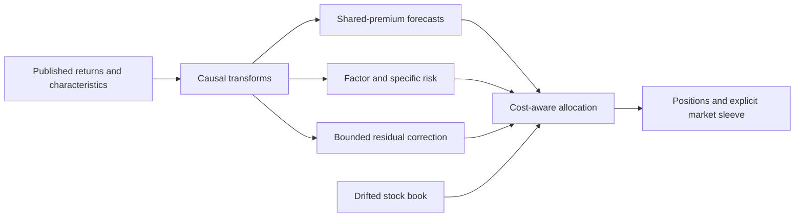

<h1 align="center">Premia Lab</h1>

<p align="center">
  <strong>From noisy premia to cost-aware portfolios.</strong><br>
  Characteristic-factor forecasts, conditional risk and an auditable research process.
</p>

<p align="center">
  <a href="https://github.com/hlemonnier/premia-lab/actions/workflows/ci.yml"></a>
  <a href="LICENSE"></a>
  <a href="requirements.txt"></a>
  <a href="examples/synthetic_demo.py"></a>
</p>

<p align="center">
  <a href="#quick-start">Quick start</a> ·
  <a href="docs/architecture.md">Architecture</a> ·
  <a href="research/README.md">Research ledger</a> ·
  <a href="docs/reproducibility.md">Reproducibility</a> ·
</p>

## The question

**How much can a modest return signal gain from better estimation, better risk forecasts and better trading decisions?**

I investigate that question in a simulated equity market. I start with 13 stock
characteristics as shared exposures, estimate the premia they earn, and separate
those expected returns from the risk and cost of holding them. The project records
what worked, what failed and which comparisons changed the research direction.

This is experimental research software, **not a live trading system or a claim of
investable alpha**. The public demo generates an independent market. The original
benchmark is absent from the maintained tree, so running that demo does not reproduce
the historical research scores. [Data and provenance boundary](NOTICE.md).

## What is here

| Component | What it contributes |
|---|---|
| **A maintained policy** | One self-contained N0 implementation, from causal features to executed positions. |
| **An inspectable research record** | Hypotheses, matched controls, rejected experiments and versioned source snapshots. |
| **Runnable public checks** | Synthetic end-to-end execution, future-mutation checks and frozen-runtime verification. |

The emphasis is on **statistical estimation and portfolio construction**. This is
not a reinforcement-learning framework, a broker connector or a collection of
backtests selected only for their headline score.

## Inside the model

N0 combines three layers:

| Layer | Question | Implementation |
|---|---|---|
| **Shared premia** | What return does each exposure earn? | A fixed 50/50 combination of pooled ridge and covariance-weighted, coefficient-wise-regularized estimates. |
| **Conditional risk** | How risky are those exposures today? | Characteristic-factor covariance, bounded multihorizon variance corrections and stock-specific risk. |
| **Residual dynamics** | Is anything left after the common effects? | A small, causally selected own-stock correction, projected away from the core design and capped in amplitude. |

A cost-aware allocator handles linear turnover costs, estimated-beta hedging,
stock caps and adaptive sizing around the drifted book. A deliberate 5% equal-weight
market position remains explicit market exposure, not relabeled stock-selection alpha.



[Architecture and timing conventions](docs/architecture.md) explain which information
is available before each forecast, allocation and realized return.

## Quick start

Use Python **3.13**. The public demo needs no credentials or private input files.

```bash
git clone https://github.com/hlemonnier/premia-lab.git
cd premia-lab
python3.13 -m venv .venv
source .venv/bin/activate
python -m pip install -r requirements.txt
python examples/synthetic_demo.py --days 800 --stocks 64
```

On Windows, activate the environment with `.venv\Scripts\activate` instead.
No network calls are needed by the policy once dependencies are installed.
The output is labeled **demo**, not a new research result.

Run the public verification workflows:

```bash
python -m unittest discover -s tests -v
python tools/check_project.py
```

The interface is deliberately small:

```python
from model_n0 import N0Policy

policy = N0Policy()
forecasts = policy.forecast(returns, characteristics)
# Row t uses observations strictly before t.
# rebalance() receives the next forecast row, published histories and drifted weights.
```

Inputs are returns `(days, stocks)`, characteristics `(days, stocks, 13)` and one-way
trading costs `(stocks,)`. The forecast array contains both alpha and risk channels;
not every column is a stock-return prediction. [Usage and reproduction guide](docs/reproducibility.md).

## Recorded findings, including the limitations

The table summarizes **development replays on one already-examined simulated
history**, using the original fee inputs. It is not live performance, an untouched
holdout or an estimate of future Sharpe.

| Research milestone | Net Sharpe | What changed |
|---|---:|---|
| Characteristic-factor baseline | 1.4447 | Shared-premium forecasts and factor-aware allocation |
| Factor-variance adjustment | 1.4934 | Time-varying factor risk |
| Fixed premium-estimator combination | 1.5332 | Covariance-aware estimation blended with the original forecast |
| **N0 — maintained implementation** | **1.5508** | Small own-stock residual correction |

N0's recorded beta was approximately **0.093**, with annual trading costs of
**0.344%**. Its incremental Sharpe over the previous combination was only **0.0176**;
the 63-day paired-bootstrap interval was roughly **[-0.0186, +0.0539]**. Causal code
can still be overfit through repeated model selection.

The counterevidence is part of the result. Directed cross-stock signals generated
too much turnover; learned mixture weights lost to the fixed blend; and several
richer covariance models weakened allocation. N0 was discovered as an interesting
control, not a predeclared winner. The [research ledger](research/README.md) retains
the failures and matched comparisons rather than only the selected path.

## Explore the repository

| Path | Contents |
|---|---|
| [model_n0/](model_n0/) | Maintained premia, risk, residual and allocation components |
| [examples/](examples/) | Independent synthetic demonstration |
| [research/](research/) | Experiment guides, outcomes, controls and versioned archive |
| [docs/](docs/) | Architecture, methodology, reproducibility and limitations |
| [tests/](tests/) | Public end-to-end and integrity checks |
| [tools/](tools/) | Archive inspection, restoration and maintenance utilities |

There is one maintained model. Earlier implementations are research evidence,
not additional production strategies. To inspect an archived experiment:

```bash
python tools/restore_research.py --list
python tools/restore_research.py --branch research-n0-frozen-review-20261030 \
  --output /tmp/premia-n0-review
```

Restoration recreates the source layout. It does not supply benchmark inputs or
certify that a historical experiment runs in the current environment.

## Limits and next steps

All original development years have been examined. N0's sparse selections change
across refits, its incremental gain is small, estimated hedges can fail, and sizing
checks cannot bound losses under arbitrary unseen shocks. Higher-fee scenarios
are sensitivities, not duplicated transaction charges or a second objective.

My next question is whether faster residual signals need trading decisions matched
to their own persistence. That is a research direction, **not an implemented improvement**.
See the [protocol](docs/research-method.md) and [limitations](docs/limitations.md).

## License and scope

Original maintained code and associated project documentation are released under
the [MIT License](LICENSE). Third-party material and dependencies retain their own
rights; the research archive and legacy history are not a blanket redistribution
grant. [NOTICE.md](NOTICE.md) explains these boundaries.

For reproducibility, reference the exact Git commit used. Bugs and research
proposals can be discussed through the repository's issue templates.

**Related research:** [The Cost of Learning to Trade](https://github.com/hlemonnier/the-cost-of-learning-to-trade)
studies execution feedback, Bayesian inference and sequential control. It is a
separate project, not a performance benchmark for Premia Lab.

---

**Hugo Lemonnier · October 2026**  
Quantitative research. Reproducible software checks. Explicit uncertainty.
