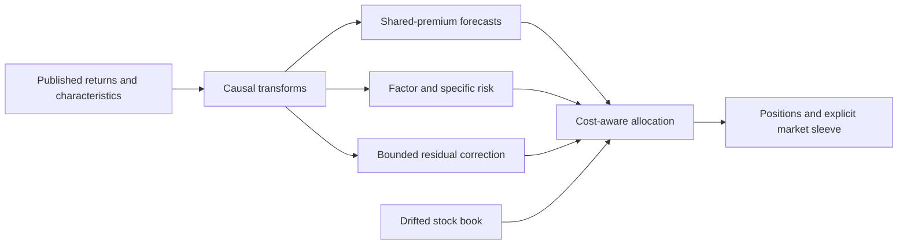

<div align="center">

# Premia Lab

**Causal forecasts · Cost-aware portfolios · Research with a paper trail**

A quantitative research workbench for characteristic-based equity strategies.


[Quick start](#quick-start) · [Architecture](docs/architecture.md) · [Research](research/README.md) · [Reproducibility](docs/reproducibility.md)

</div>

---

## The question

**How much can a modest return signal gain from better estimation, better risk forecasts and better trading decisions?**

I investigate that question in a simulated equity market. The research starts with 13 stock characteristics, treats them as shared exposures, and separates expected premia from the risk of holding them. The interesting findings are not just the configurations with the highest historical score: matched controls, rejected ideas and causal checks are part of the project.

This is research code, not a live trading system or a claim of investable alpha. The original benchmark data are not distributed. The public demonstration below generates a different market and is deliberately not presented as a replication of the historical results.

## What is in the model

The current implementation is **N0**, a single self-contained policy with three layers:

| Layer | Question | Implementation |
|---|---|---|
| **Shared premia** | What return does each exposure earn? | A fixed 50/50 combination of pooled ridge and covariance-weighted, coefficient-wise-regularized estimates. |
| **Conditional risk** | How risky are those exposures today? | Characteristic-factor covariance, bounded multihorizon variance corrections and stock-specific risk. |
| **Residual dynamics** | Is anything left after the common effects? | A small, causally selected own-stock residual correction, projected away from the core design and capped in amplitude. |

A transaction-cost-aware allocator turns the forecast into positions. It handles linear turnover costs, estimated-beta hedging, stock caps and adaptive sizing. A deliberate 5% equal-weight market position is explicit market exposure—not relabeled alpha.



See [the architecture](docs/architecture.md) for timing conventions and the difference between the internal stock book and the combined traded portfolio.

## Quick start

Use Python **3.13** and run from the repository root:

```bash
python -m venv .venv
source .venv/bin/activate
python -m pip install -r requirements.txt
python examples/synthetic_demo.py --days 800 --stocks 64
```

On Windows, activate the environment with `.venv\Scripts\activate` instead.

The command generates a small independent market, computes forecasts and rebalances the actual policy. Its output is labeled **demo**, not a new research result. No credentials, private files or network calls are needed once dependencies are installed.

To run the public end-to-end checks:

```bash
python -m unittest discover -s tests -v
python tools/check_project.py
```

The Python interface is intentionally small:

```python
from model_n0 import N0Policy

policy = N0Policy()
forecasts = policy.forecast(returns, characteristics)
# Forecast row t uses observations strictly before t.
# rebalance() receives the next forecast row, published histories and drifted weights.
```

Inputs are daily returns `(days, stocks)`, characteristics `(days, stocks, 13)` and one-way trading costs `(stocks,)`. The forecast array contains both alpha and risk channels; do not treat every column as a stock return. [Usage and reproduction notes →](docs/reproducibility.md)

## What the historical research found

These are **recorded development replays on one already-examined simulated history**, with the original fee inputs. They are not live returns, fresh holdouts or a forecast of future Sharpe.

| Research milestone | Net Sharpe | What changed |
|---|---:|---|
| Characteristic-factor baseline | 1.4447 | Shared-premium forecasts and factor-aware allocation |
| Factor-variance adjustment | 1.4934 | Time-varying factor risk |
| Fixed premium-estimator combination | 1.5332 | Covariance-aware estimation blended with the original forecast |
| N0 — current implementation | **1.5508** | Small own-stock residual correction |

N0's recorded beta was approximately **0.093**, with annual trading costs of **0.344%**. Its incremental Sharpe over the previous combination was only **0.0176**, with a 63-day paired-bootstrap interval of roughly **[-0.0186, +0.0539]**. A causal implementation can still be overfit through repeated model selection.

I retain negative results rather than presenting a sequence of inevitable improvements: directed cross-stock signals generated too much turnover, learned mixture weights lost to the fixed blend, and several richer covariance models weakened the portfolio. The [research ledger](research/README.md) includes those outcomes and the controls behind them.

## Explore the project

```text
model_n0/       The current policy: premia, risk, residuals and allocation
strategy.py     Thin compatibility entry point for array-based replay
examples/       Independent synthetic demonstration
research/       Experiment guide, outcomes and versioned research archive
  experiments/  Reading guides for the imported branch snapshots
  archive/      Deduplicated source/report objects and provenance index
docs/           Architecture, research protocol, limitations and data boundary
tests/          Public end-to-end checks and frozen-runtime verification
tools/          Archive inspection, restoration and publication utilities
```

There is one maintained model, not a collection of selectable production strategies. Previous implementations are preserved as research evidence. To inspect or restore a historical experiment:

```bash
python tools/restore_research.py --list
python tools/restore_research.py --branch research-n0-frozen-review-20261030 \
  --output /tmp/premia-n0-review
```

Restoration recreates the archived source layout; it does not supply the private inputs or certify that an old experiment runs in today's environment.

## Limits and next steps

The most important limitation is the absence of an untouched evaluation sample in the published evidence. N0's sparse selections change across refits; its gain is small; the estimated hedge can fail; and historical sizing checks do not bound losses under arbitrary unseen shocks. Higher-fee scenarios are sensitivities, not a second objective or duplicated transaction charges.

The next substantive question is whether faster residual signals should have trading decisions matched to their own persistence. That is an open research direction here, **not an implemented improvement**. [Research protocol](docs/research-method.md) · [Limitations](docs/limitations.md)

---

**Hugo Lemonnier · October 2026**  
Research results are descriptive. No live-trading performance or guaranteed future advantage is claimed.
